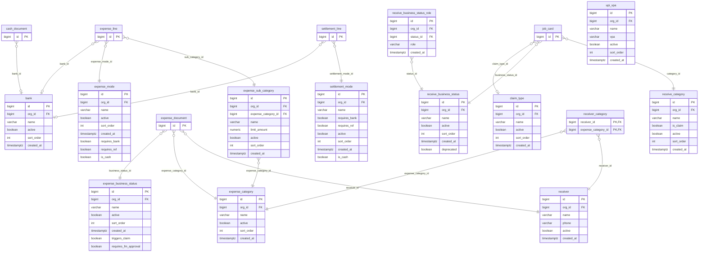
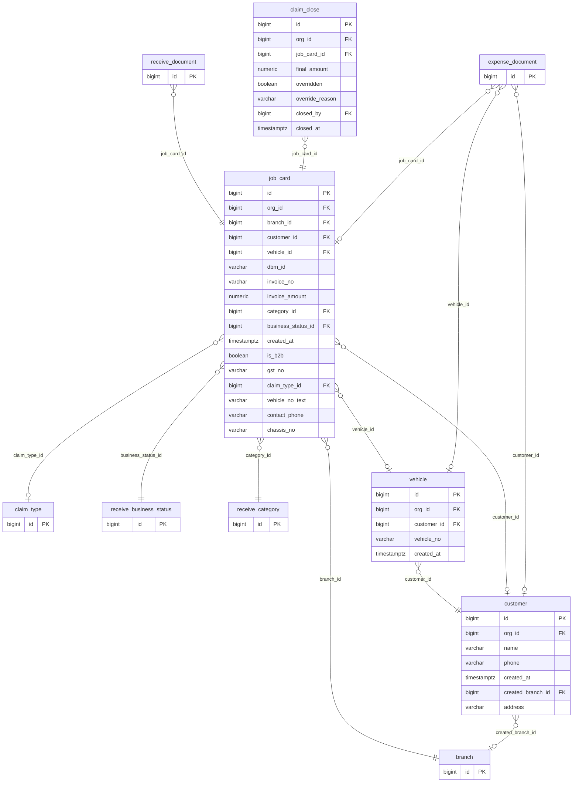
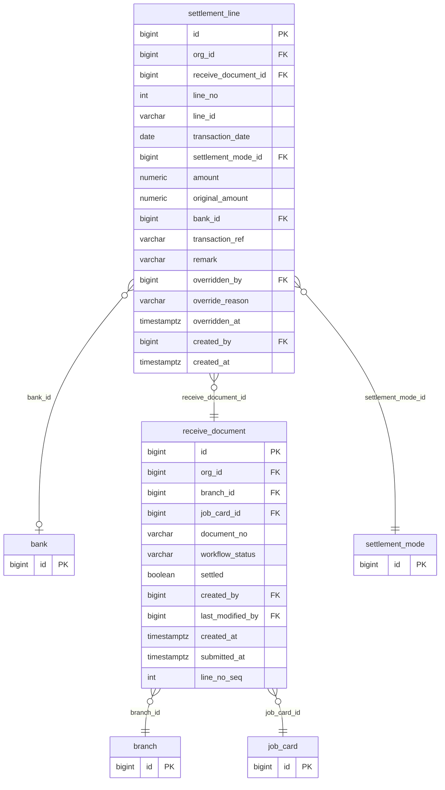
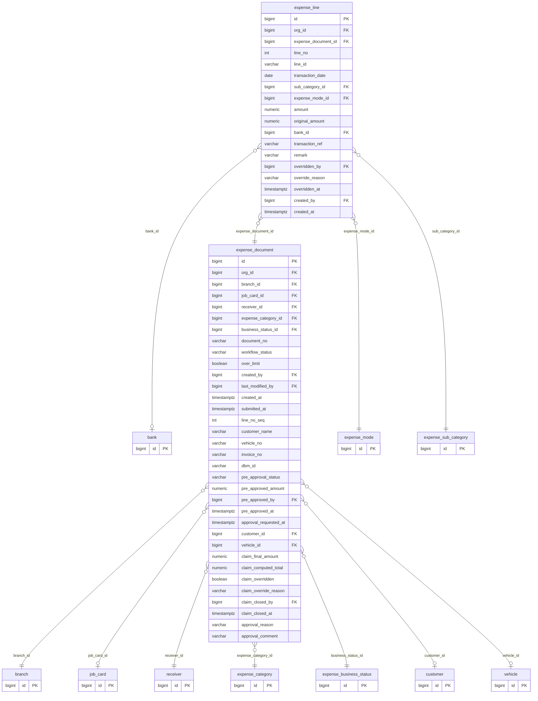
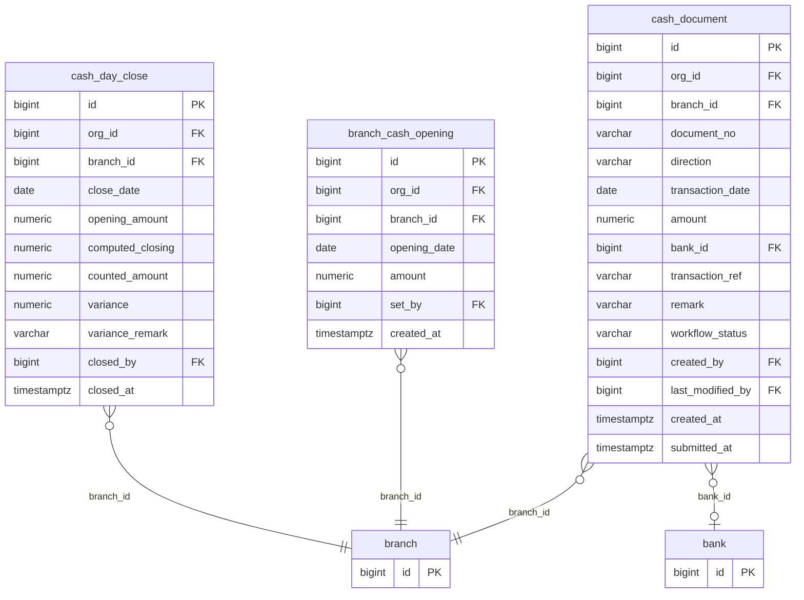
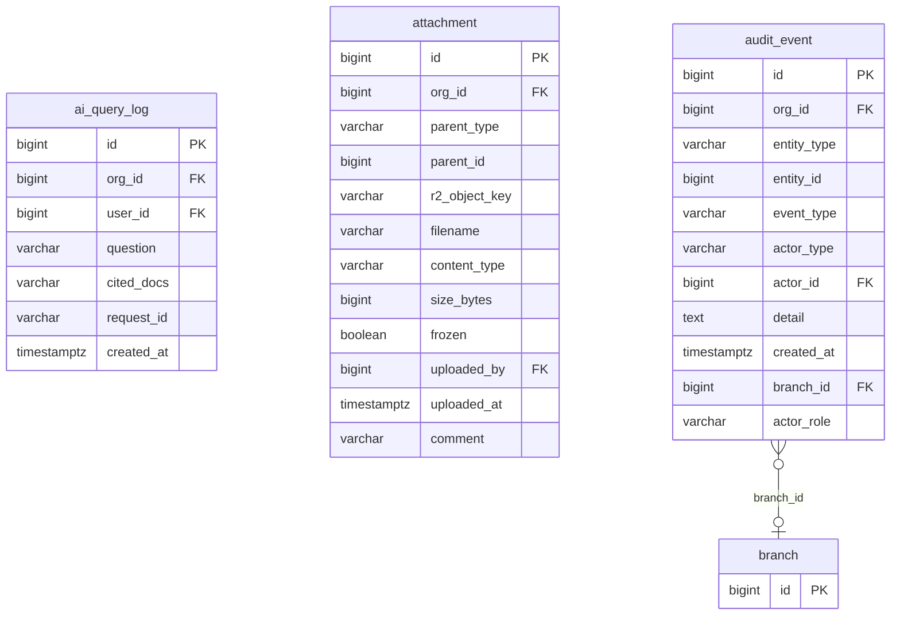

# DAMS database schema

The whole PostgreSQL schema as Mermaid diagrams (GitHub draws them). It is **generated from the real database** with every
Flyway migration applied — 34 tables, 89 foreign keys — so it matches the code. Regenerate it after adding a
migration: `python3 scripts/generate-db-diagram.py` (see the top of that script).

**How to read it:** `PK` primary key · `FK` foreign key · `UK` unique. A solid crow’s-foot line `}o--||` means *many rows point at
exactly one parent*; `}o--o|` means the link is optional (the column may be empty). The label on a line is the column that holds
the link. To keep the pictures readable, three kinds of link are not drawn as lines (the column is still listed with `FK`):
links to `organization` (almost every table has an `org_id` — one organisation’s data never mixes with another’s), links to
`app_user` (who created or changed a row), and — in the overview only — links to `branch`.

> Not drawn: `flyway_schema_history` (Flyway’s own bookkeeping).

## 1. The whole picture

Every table and every link, without columns. Start here, then open the group you need below.

```mermaid
erDiagram
  ai_query_log {
    bigint id PK
  }
  app_user {
    bigint id PK
  }
  attachment {
    bigint id PK
  }
  audit_event {
    bigint id PK
  }
  bank {
    bigint id PK
  }
  branch {
    bigint id PK
  }
  branch_cash_opening {
    bigint id PK
  }
  cash_day_close {
    bigint id PK
  }
  cash_document {
    bigint id PK
  }
  claim_close {
    bigint id PK
  }
  claim_type {
    bigint id PK
  }
  customer {
    bigint id PK
  }
  document_sequence {
    bigint id PK
  }
  expense_business_status {
    bigint id PK
  }
  expense_category {
    bigint id PK
  }
  expense_document {
    bigint id PK
  }
  expense_line {
    bigint id PK
  }
  expense_mode {
    bigint id PK
  }
  expense_sub_category {
    bigint id PK
  }
  job_card {
    bigint id PK
  }
  organization {
    bigint id PK
  }
  platform_setting {
    bigint id PK
  }
  receive_business_status {
    bigint id PK
  }
  receive_business_status_role {
    bigint id PK
  }
  receive_category {
    bigint id PK
  }
  receive_document {
    bigint id PK
  }
  receiver {
    bigint id PK
  }
  receiver_category {
    bigint id PK
  }
  settlement_line {
    bigint id PK
  }
  settlement_mode {
    bigint id PK
  }
  upi_vpa {
    bigint id PK
  }
  user_branch_access {
    bigint id PK
  }
  user_role_grant {
    bigint id PK
  }
  vehicle {
    bigint id PK
  }
  expense_sub_category }o--|| expense_category : "expense_category_id"
  vehicle }o--|| customer : "customer_id"
  job_card }o--o| customer : "customer_id"
  job_card }o--o| vehicle : "vehicle_id"
  job_card }o--|| receive_category : "category_id"
  job_card }o--|| receive_business_status : "business_status_id"
  receive_document }o--|| job_card : "job_card_id"
  settlement_line }o--|| receive_document : "receive_document_id"
  settlement_line }o--|| settlement_mode : "settlement_mode_id"
  settlement_line }o--o| bank : "bank_id"
  claim_close }o--|| job_card : "job_card_id"
  expense_document }o--o| job_card : "job_card_id"
  expense_document }o--|| receiver : "receiver_id"
  expense_document }o--|| expense_category : "expense_category_id"
  expense_document }o--|| expense_business_status : "business_status_id"
  expense_line }o--|| expense_document : "expense_document_id"
  expense_line }o--|| expense_sub_category : "sub_category_id"
  expense_line }o--|| expense_mode : "expense_mode_id"
  expense_line }o--o| bank : "bank_id"
  cash_document }o--o| bank : "bank_id"
  job_card }o--o| claim_type : "claim_type_id"
  receive_business_status_role }o--|| receive_business_status : "status_id"
  expense_document }o--o| customer : "customer_id"
  expense_document }o--o| vehicle : "vehicle_id"
  receiver_category }o--|| receiver : "receiver_id"
  receiver_category }o--|| expense_category : "expense_category_id"
```

## 2. People, branches and the organisation

Who can sign in, which branches they see, and the numbering of documents.

Tables in this group: `organization`, `platform_setting`, `branch`, `app_user`, `user_role_grant`, `user_branch_access`, `document_sequence`.

```mermaid
erDiagram
  app_user {
    bigint id PK
    bigint org_id FK
    bigint home_branch_id FK
    varchar name
    varchar email UK
    varchar password_hash
    varchar role
    boolean active
    varchar invite_token
    timestamptz invite_expires_at
    timestamptz created_at
  }
  audit_event {
    bigint id PK
  }
  branch {
    bigint id PK
    bigint org_id FK
    varchar name
    varchar code
    boolean active
    timestamptz created_at
  }
  branch_cash_opening {
    bigint id PK
  }
  cash_day_close {
    bigint id PK
  }
  cash_document {
    bigint id PK
  }
  customer {
    bigint id PK
  }
  document_sequence {
    bigint id PK
    bigint org_id FK
    bigint branch_id FK
    varchar month_key
    varchar doc_type
    int last_seq
  }
  expense_document {
    bigint id PK
  }
  job_card {
    bigint id PK
  }
  organization {
    bigint id PK
    varchar name
    boolean multi_branch_cashier_access
    boolean active
    timestamptz created_at
    boolean accountant_direct_approve_cash
  }
  platform_setting {
    varchar key PK
    varchar value
    timestamptz updated_at
    bigint updated_by FK
  }
  receive_document {
    bigint id PK
  }
  user_branch_access {
    bigint user_id PK, FK
    bigint branch_id PK, FK
  }
  user_role_grant {
    bigint id PK
    bigint org_id FK
    bigint user_id FK
    varchar role
    bigint branch_id FK
    timestamptz created_at
  }
  document_sequence }o--|| branch : "branch_id"
  app_user }o--o| branch : "home_branch_id"
  user_branch_access }o--|| branch : "branch_id"
  job_card }o--|| branch : "branch_id"
  receive_document }o--|| branch : "branch_id"
  expense_document }o--|| branch : "branch_id"
  cash_document }o--|| branch : "branch_id"
  branch_cash_opening }o--|| branch : "branch_id"
  cash_day_close }o--|| branch : "branch_id"
  audit_event }o--o| branch : "branch_id"
  user_role_grant }o--o| branch : "branch_id"
  customer }o--o| branch : "created_branch_id"
```

## 3. Masters (Owner-editable lists)

Every dropdown comes from these tables; rows are deactivated, never deleted.

Tables in this group: `receive_category`, `receive_business_status`, `receive_business_status_role`, `claim_type`, `settlement_mode`, `bank`, `upi_vpa`, `expense_category`, `expense_sub_category`, `expense_mode`, `expense_business_status`, `receiver`, `receiver_category`.

## 4. Customers, vehicles and job cards

The identity of who we deal with, and the job a receipt or expense belongs to.

Tables in this group: `customer`, `vehicle`, `job_card`, `claim_close`.

## 5. Receipts

Money received from a customer: one document per job card, with one line per payment.

Tables in this group: `receive_document`, `settlement_line`.

## 6. Expenses

Money paid out to a vendor (receiver), with one line per payment.

Tables in this group: `expense_document`, `expense_line`.

## 7. Cash

Cash in and out of the drawer, the daily close, and each branch’s opening balance.

Tables in this group: `cash_document`, `cash_day_close`, `branch_cash_opening`.

## 8. Audit, attachments and AI

The trail of who did what, uploaded bills and proofs, and the Ask-DAMS query log.

Tables in this group: `audit_event`, `attachment`, `ai_query_log`.

