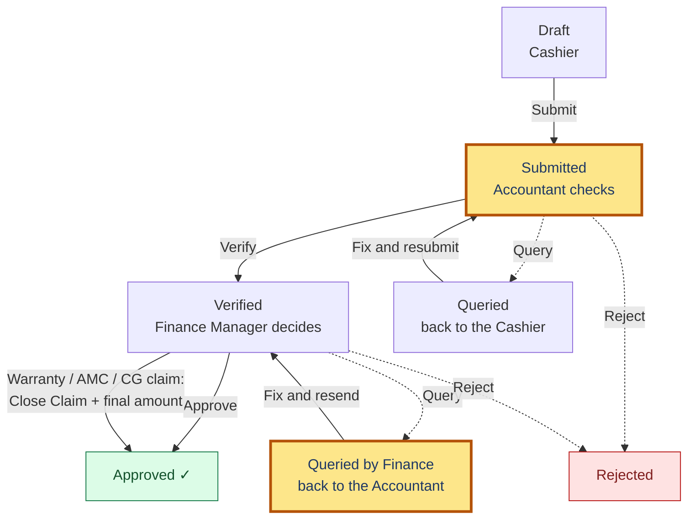
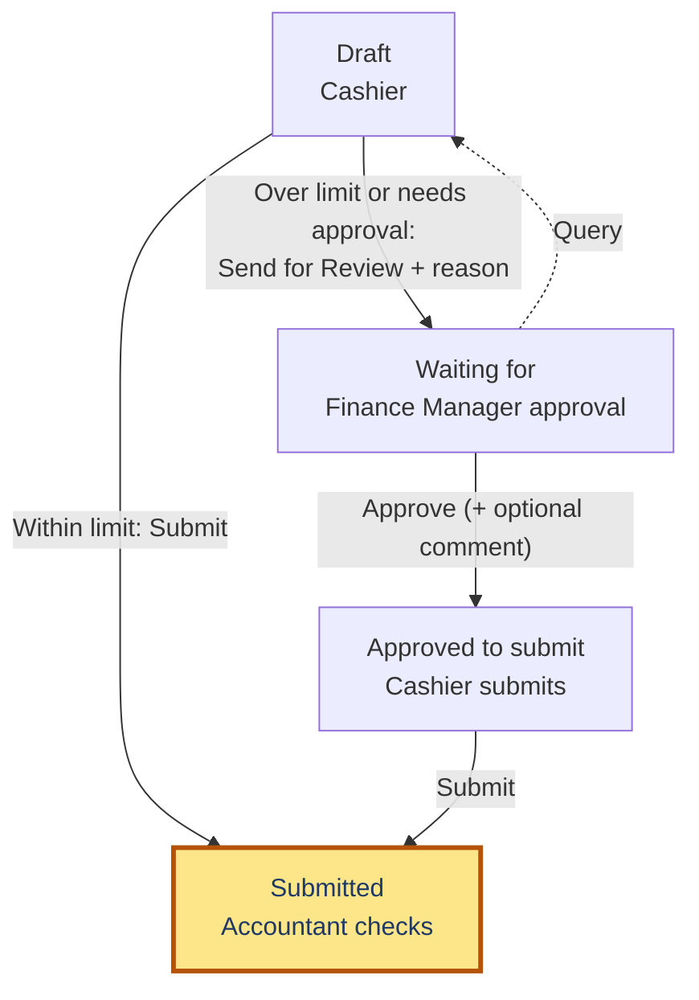
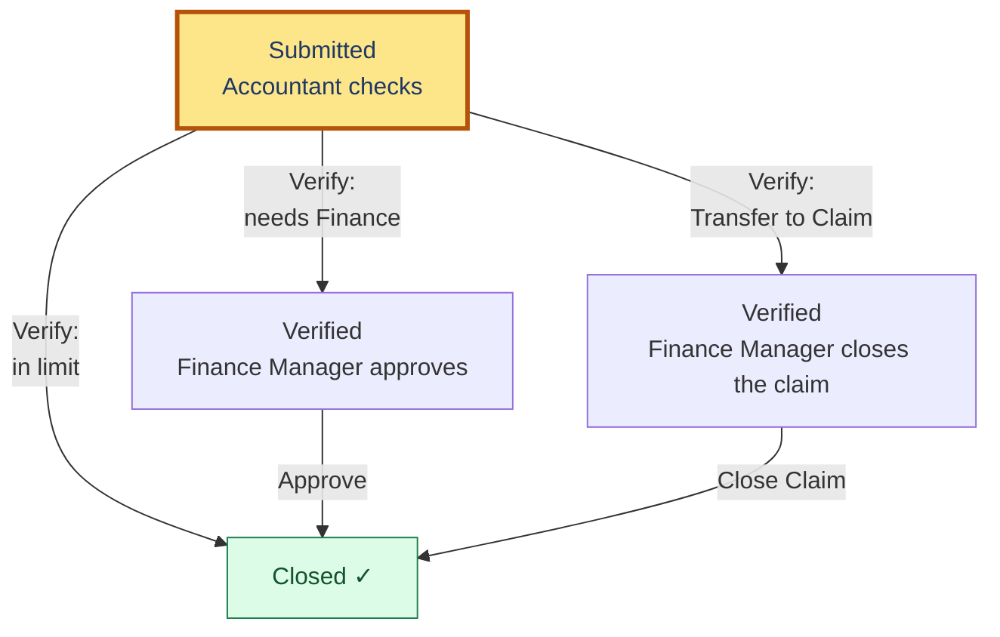
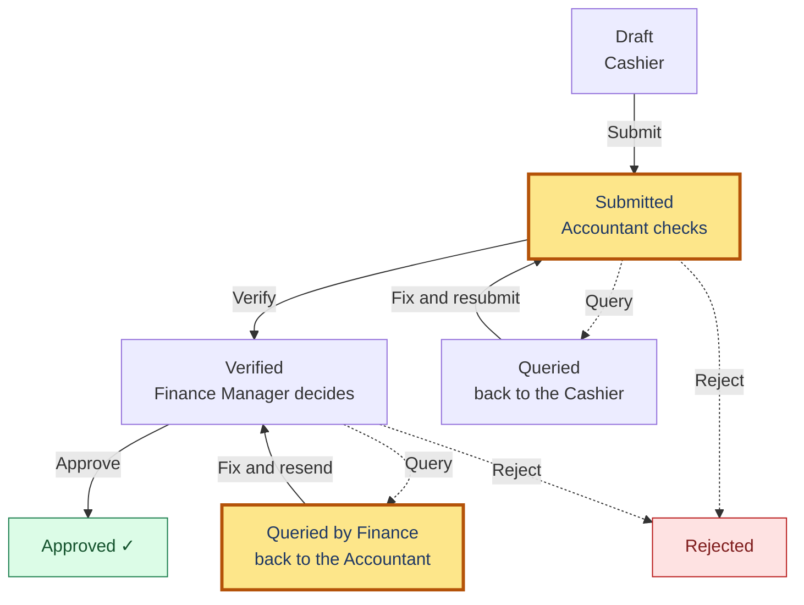

# Where is it — and what’s next?

You are the **middle step**. Entries reach you from the cashier, and leave you for the finance manager (or close, for an ordinary expense).

**How to read the pictures:** a **yellow** box is a step that is **yours**. Green is finished. Dashed lines are queries and rejections.

## Receipts

Money received from a customer.

## Expenses

Money paid out.

### Getting it submitted

### After it is submitted

At any step it can be sent back with a **query**: the accountant’s query goes to the cashier; the finance manager’s query goes to the accountant. A **rejected** expense is finished.

## Cash in and out

Money moved in or out of the drawer.

## Your steps

- **Submitted** — open it and **Verify**, **Query** (back to the cashier) or **Reject**.
- **Queried by Finance Manager** — fix it (override an amount if needed) and **resend it to Finance**. It does not go back to the cashier.
- **Expenses:** when you verify an ordinary in-limit expense, it **closes by itself**. One that needs Finance waits for the finance manager. A **Transfer to Claim** expense waits for the finance manager’s **Close Claim** — you don’t close it.
- An expense verified before auto-close existed may still show **Verified** — press **Close expense** on it.

## Where to find it

- **Review queue** — your tabs for Receipts, Expenses and Cash. **Pending & closed** shows what you already handled.
- Your own entries are blocked from you: someone else must check them.

## What every status means

| What the status says | Who has it now | What happens next |
|---|---|---|
| **Draft** | Cashier | The cashier finishes it and presses **Submit** (or **Send for Review** if an expense needs approval first). |
| **Waiting for FM approval** *(expense)* | Finance Manager | They **Approve** (with an optional comment) or **Query** it back. Then the cashier submits. |
| **Submitted** | Accountant | They **Verify**, **Query** or **Reject**. |
| **Queried** | Cashier | The cashier reads the note, fixes it and resubmits. |
| **Verified** | Finance Manager | They **Approve**, **Query** or **Reject**. An in-limit expense never waits here — it closes when verified. A claim waits here for **Close Claim**. |
| **Queried by Finance Manager** | Accountant | The accountant fixes it and resends it straight to the Finance Manager. |
| **Approved** | Nobody — it's done | Locked. A new payment added later reopens a receipt for review. |
| **Closed** *(expense)* | Nobody — it's done | Locked for good. |
| **Rejected** | Nobody — it's finished | The entry doesn't stand. |

**Tip:** if your organisation allows it, you can approve an all-cash receipt directly, skipping the finance manager.
