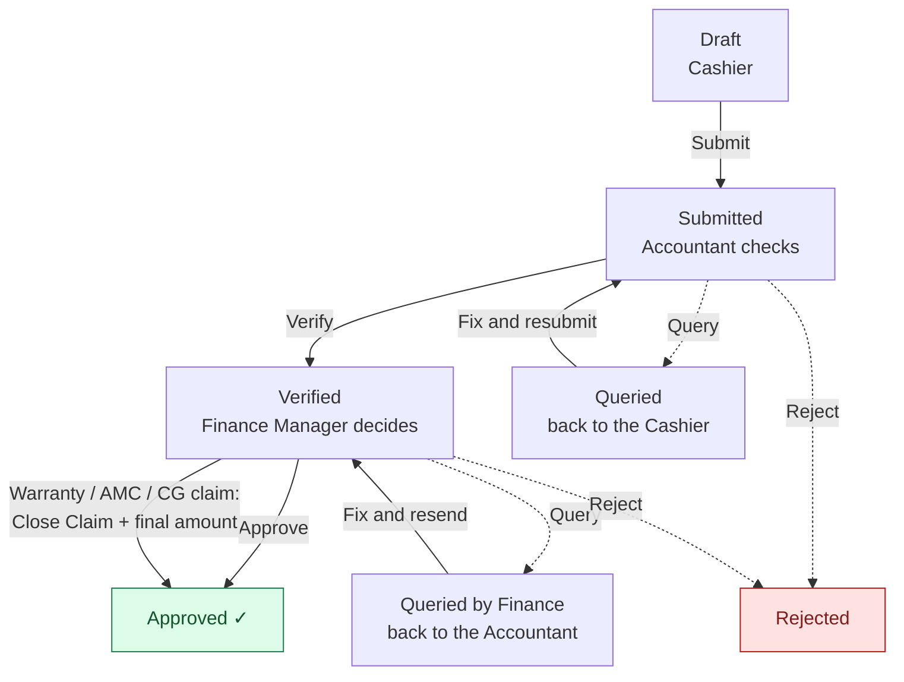
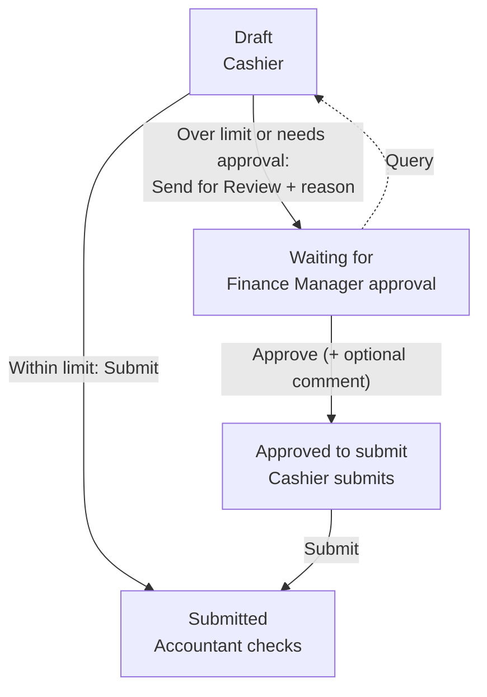
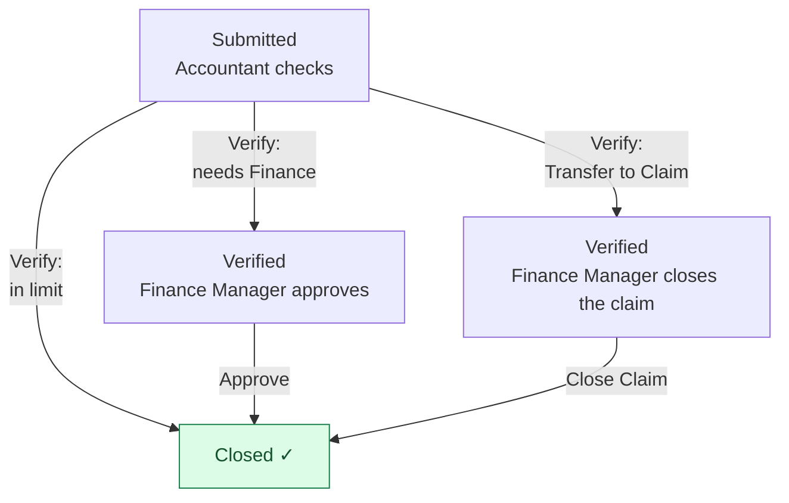
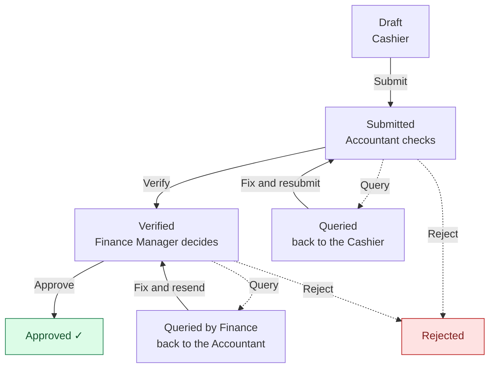
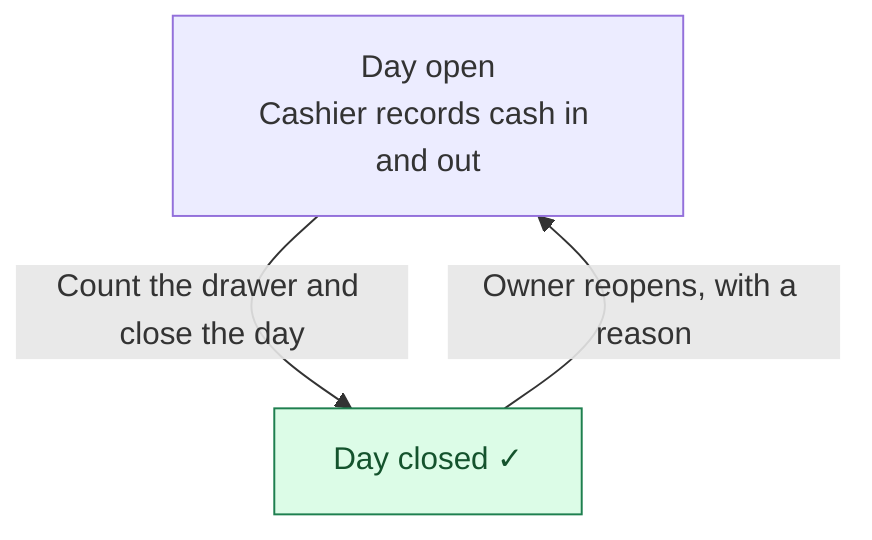

# Where is it — and who is holding it?

You don’t move documents along — the cashier, accountant and finance manager do. But you can always see **where each one is and who is holding it**.

**How to read the pictures:** a **yellow** box is a step you can watch (none are yours to press). Green is finished. Dashed lines are queries and rejections.

## Receipts

Money received from a customer.

## Expenses

Money paid out.

### Getting it submitted

### After it is submitted

At any step it can be sent back with a **query**: the accountant’s query goes to the cashier; the finance manager’s query goes to the accountant. A **rejected** expense is finished.

## Cash in and out

Money moved in or out of the drawer.

### Closing the day

## Your steps

- Watch, don’t push: the people on each step press the buttons.
- You **can** change an expense’s status, and **reopen a closed cash day** (with a reason).

## Where to find it

- **Dashboard → Stuck with whom** — counts for the Cashier, the Accountant and the Finance Manager. Click a tile to see the entries and how long they have waited.
- **Expenses** — every expense in every branch, with its status.
- **Dashboard → Awaiting approval** — what is submitted or verified but not yet final.

## What every status means

| What the status says | Who has it now | What happens next |
|---|---|---|
| **Draft** | Cashier | The cashier finishes it and presses **Submit** (or **Send for Review** if an expense needs approval first). |
| **Waiting for FM approval** *(expense)* | Finance Manager | They **Approve** (with an optional comment) or **Query** it back. Then the cashier submits. |
| **Submitted** | Accountant | They **Verify**, **Query** or **Reject**. |
| **Queried** | Cashier | The cashier reads the note, fixes it and resubmits. |
| **Verified** | Finance Manager | They **Approve**, **Query** or **Reject**. An in-limit expense never waits here — it closes when verified. A claim waits here for **Close Claim**. |
| **Queried by Finance Manager** | Accountant | The accountant fixes it and resends it straight to the Finance Manager. |
| **Approved** | Nobody — it's done | Locked. A new payment added later reopens a receipt for review. |
| **Closed** *(expense)* | Nobody — it's done | Locked for good. |
| **Rejected** | Nobody — it's finished | The entry doesn't stand. |

**Reading “stuck”:** if one person holds many entries for days, ask them. *Approved* and *Closed* entries are held by nobody — they are finished.
